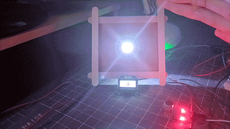

This is a simple lamp I built with an Arduino and a few components, including an audio sensor and an OLED screen.

I made mine with stuff I had lying around the house, and I think that was the best part.

